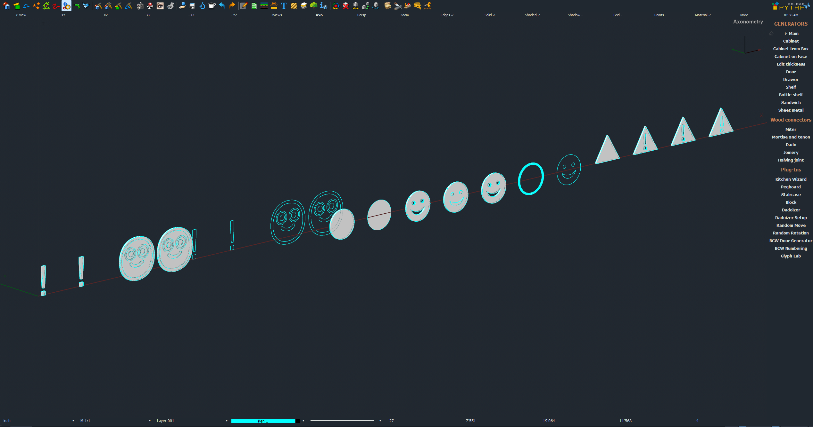

# Glyph Lab 0.6

A test plugin. It builds a smiley and a warning "!" sign several ways and reports, call by call, what this PYTHA install accepts (pcall around every call, exact error text kept). Variants land in one top-level group "Glyph Lab", side by side in the front view.

Variants: text (`create_text_3d`, with and without origin/options, with an emoji character), text as pure linework (`create_text_engraving`), one extruded face with real cut-out holes (`create_polygon_ex` + `create_profile`), layered coloured parts, boolean difference, `create_ring`, and outline-only polylines. Optional plot-sheet tests (tick "sheet tests" in the dialog) make a sheet and try `pyplot.insert_detail` and `pyplot.insert_text`, and probe whether the `pydim` namespace exists.

Install: copy this folder to `%AppData%\Roaming\PYTHA26.0\plugins\`, restart PYTHA, run "Glyph Lab". Send back the report from the alert (also saved as `glyph_lab_report.txt` in the plugin scratch folder when writable).

Built and tested on PYTHA V26 (compiled 2026-07-20 14:19:45); on that build the report was 47 ok, 1 failed (`pydim` missing). Log your own compile date next to any report you send, since PYTHA has no build numbers.
