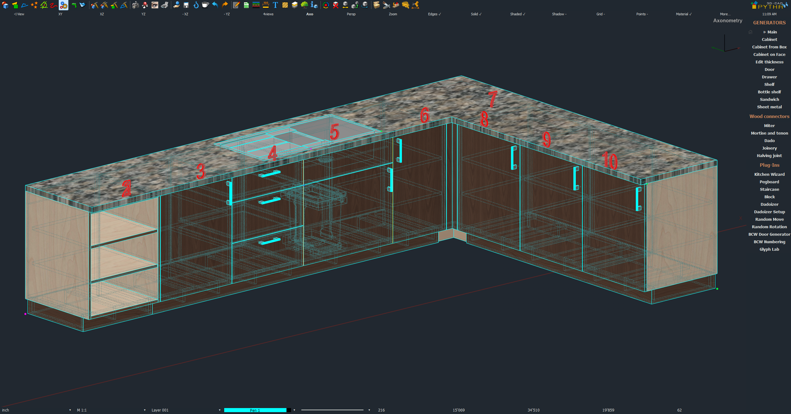

# Group Numbering v1.7

PYTHA plugin (V26). Numbers every top-level group in the model, in order round the room (left to right along each run), so each one carries a number through to the Parts List.

- **Any top-level group** counts as one item, whatever made it.
- **Kitchen Wizard kitchens** are the exception: each cabinet inside the kitchen gets its own number, not the kitchen as a whole (its Benchtop and Kickboard groups are skipped).
- **Order:** bases first (Kitchen Wizard base and tall cabinets, plus every other top-level group), then uppers (Kitchen Wizard wall cabinets).
- **Facing (new in 1.5):** each cabinet is ordered by the way it faces, not just along the x axis. Runs are walked clockwise round the room (left wall, back wall, right wall, front wall, as seen from above), and inside a run the numbers go left to right as seen from the front of the cabinets. The 3D labels sit on the front face and read from the front. The facing comes from `pytha.get_group_angle` (V26), assuming angle 0 faces -y. Untick "Order by each cabinet's facing" for the old left-to-right-along-x order.
- **Part boxes (new in 1.7):** centres and label positions come from the box of each group's parts, not the group's own bounding box. On V26 a group's own box also covers its reference points (connection, hinge and handle points), which can stretch it, move its centre and put a number out of order. Untick "Use the parts' own box" to get the 1.5 behaviour. A reference point that sits on a part itself still counts.

What each number does:
- It is written to the group's position number, so the Parts List can show it.
- It is appended to the group name ("Base" becomes "Base #3").
- Optionally, it is placed as an upright 3D label above the group.

Existing numbers are kept; only new groups get the next free number. *Renumber everything* restarts the sequence.

## Install
1. Open PYTHA's plugin directory: `%AppData%\PYTHA26.0\plugins` (paste that into the Windows Explorer address bar).
2. Copy this whole folder, `Group Numbering v1.7`, into it. Keep the folder itself; don't copy just the files out of it.
3. Restart PYTHA. **Group Numbering** appears in the plugin sidebar.

## How to use
1. Run **Group Numbering** from the plugin sidebar and choose **Number Groups** (or **Remove number labels**).
2. Set the options: start number, *Renumber everything*, add number to name, 3D labels, label height, layer and pen.
3. Not sure the angles are read the right way? Tick **Preview the order only** first: it lists every group with its number, angle and centre and changes nothing. A note appears on any group whose reference points would have moved its centre. If the order comes out mirrored, tick **Flip the angle sign**.
4. Click OK. Re-run after any change; old labels are replaced. Removing labels leaves the numbers and names on the groups.

Note: running Kitchen Wizard *Edit* rebuilds the kitchen, so its cabinets lose their numbers and get new ones on the next run.
