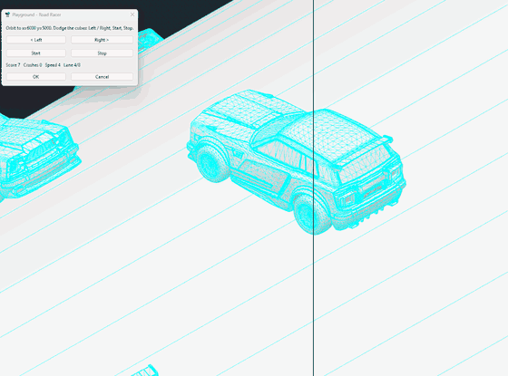

# Playground v0.1

Small games that double as practice for the PYTHA Lua API. One toolbar entry opens a picker; each game builds its scene far from the origin (x >= 5000 mm) and deletes it when you close the dialog.

## Road Racer

The car stays still, a big cylinder spins under it and obstacles ride on the cylinder. **Left / Right** change lane, **Start / Stop** run the timer. Score = obstacles passed, crashes are counted. Speed rises with score. The road always turns the same way; if it turns toward the wrong side on your build, change `DIR` in the `ROAD` table at the top of the Road Racer section (1 or -1).

**Models.** A dialog before the game lets you pick any `.pyo` for the car and for the obstacles (remembered between runs), or leave plain boxes. With a car model the lanes are made 1.25 x the car's width and the crash window comes from its length. Models keep their native size (no scaling). *Copy models to scene* puts copies of them into the model so you can texture them, save them as new `.pyo` files and pick those. Tuning (`ROAD` table): `radius`, `lanes`, `count` (obstacles around the ring), `turn_scale`, `car_turn` / `cube_turn` (degrees about z).

## Sheet Tetris
Door-shaped parts fall onto a 4 x 8 sheet standing up (4 in cells). **Left / Right / Turn / Drop**, **Start / Stop**. No row clearing: the score is how much of the sheet you used and the waste percentage when a part can no longer spawn.

## Facts it is built on (BCW Test Suite 24 and 25, V26)
- Timers start only from inside a dialog; the callback fires about 13 times a second, so speed is scaled by the callbacks measured per wall-clock second.
- The animation handler's argument is not elapsed seconds, so the animation calls are not used.
- Arrow keys give no calls from a dialog, so every control is a button.
- Updating a dialog label from a callback fails now and then, so it is wrapped and done every few frames.

## Status
Both games run in PYTHA V26 (backlog T60); Sheet Tetris tested and works well. Road Racer was tested with 17 Fennec models on an 11200 mm radius cylinder with no lag. Still to confirm: model rotation after the last change, and textured `.pyo` files keeping their materials on import.

`road-racer.gif` is a compressed 14 s clip (the original capture was 55 MB, kept out of the repo).

Install: copy the folder to `%AppData%\Roaming\PYTHA26.0\plugins\`, restart PYTHA.
