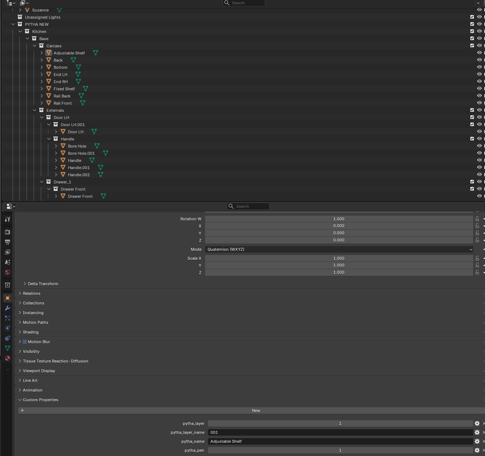

# Pytha to Blender Import

Two parts that work together to bring a PYTHA model into Blender intact:

| Folder | Runs in | Does |
|---|---|---|
| `Export Tags v1.0/` | PYTHA V26 (plugin) | Saves each part's layer and pen into its name before export, then removes them again |
| `Blender Add-on/pytha_gltf_importer.py` | Blender 4.2+ / 5.x | Imports the glTF/GLB with the group tree, exact names, layers and pens |

PYTHA's glTF export drops layers and pens, and Blender's own importer turns the group tree into 100+ empties and mangles names like `0948_L204,H27,W18.5`. Together these fix that.

## Install
- **PYTHA:** copy the whole `Export Tags v1.0` folder into PYTHA's plugin directory (`%AppData%\PYTHA26.0\plugins`), keeping the folder itself, and restart PYTHA.
- **Blender:** *Edit > Preferences > Add-ons > Install from Disk*, pick `pytha_gltf_importer.py`, and enable it.

## How to use
1. In PYTHA, run **Tag parts for export**. Each part name gets a tag like `{L<layer>:<layer name> P<pen>}`.
2. Export glTF/GLB from PYTHA.
3. Run **Remove export tags** to restore the original part names.
4. In Blender: *File > Import > PYTHA (.glb/.gltf)*, set the options and import.

## What the importer gives you
- PYTHA's group tree as nested collections.
- Part names kept exactly (also stored in the `pytha_name` custom property).
- Layers and pens as custom properties (`pytha_layer`, `pytha_layer_name`, `pytha_pen`) and as `Layers /` and `Pens /` collections, so you can browse by group or by layer.
- Optional: swap in materials from a library `.blend` by matching name, merge vertices by distance, and mark hard edges as UV seams.

Diagnostic output: *Window > Toggle System Console* (Windows).

## Where to find the results in Blender

- **Outliner:** PYTHA's group tree (here Kitchen > Base > Carcass / Externals > Drawer_1 ...) is a nested collection tree, with part names exactly as in PYTHA. If the layer and pen collections are enabled in the import dialog, `Layers /` and `Pens /` collections are added alongside.
- **Properties editor > Object tab > Custom Properties:** `pytha_name`, `pytha_layer`, `pytha_layer_name` and `pytha_pen` for the selected part.

## Tested
Blender 5.2 with a glTF exported from PYTHA V26 (a Kitchen Wizard kitchen: 104 parts in 43 groups). All 104 parts were tagged and the importer found the tags. That model had a single layer, and only one part's pen (1) was inspected, so a model with several layers and pens still needs checking.
